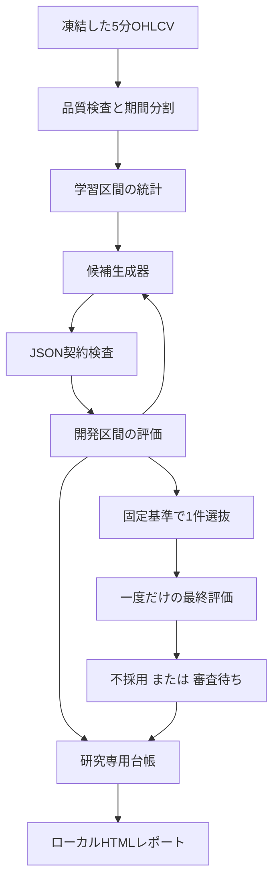

# AI自己改善エンジン 技術書

対象版：`ai-self-improvement-v0.1`。権限と採否の正本は [SOURCE_OF_TRUTH.md](SOURCE_OF_TRUTH.md) です。
本書はその実装方法を説明します。予定の機能と実装済み機能を混同しないでください。

## 1. 構成と権限



この構成に、既存Botへの設定書込み・発注・デプロイの矢印はありません。
研究用プロセスは既存 `app/strategy.py` の純粋な計算関数を参照しますが、market worker、news worker、DB、取引所クライアントは起動しません。
候補は実行可能コードではなく、有限の条件名と数値です。

| モジュール | 役割 |
|---|---|
| `policy.json` / `contracts.py` | 数値ポリシー、候補Schema、型・範囲・起動時の拒否条件 |
| `dataset.py` | CSV検査、期間分割、合成入力 |
| `provider.py` | 固定応答、Responses API契約の組立て・応答検証 |
| `evaluator.py` | 5分足の集約、指標・時系列シグナル・費用込みシミュレーション |
| `screening.py` | AIから独立した採否基準 |
| `ledger.py` | 試行予約、候補・結果、最終期間の使用記録、監査 |
| `engine.py` | 有限の候補生成・評価ループと選抜 |
| `report.py` | 台帳からHTMLを生成。スクリプトなし |
| `__main__.py` | オフラインCLI。実providerは選べない |

Python標準ライブラリで動きます。MVPにOpenAI SDK、CCXT、PostgreSQL接続情報は不要です。

## 2. 候補JSONの意味

`proposal_schema()` がポリシーからJSON Schemaを構築します。すべてのフィールドを必須とし、`additionalProperties=false` とします。
受信側でもローカル検証を行います。JSON Schemaだけでは表し切れない `ema_fast < ema_slow`、必須フィルター、フィルター重複も確認します。

```json
{
  "schema_version": "1",
  "name": "research-candidate-example",
  "timeframe_minutes": 120,
  "ema_fast": 21,
  "ema_slow": 55,
  "rsi_period": 9,
  "rsi_threshold": 55,
  "rsi_window": 3,
  "atr_period": 14,
  "stop_atr": 3,
  "target_atr": 12,
  "entry_filters": ["local_trend", "slow_rising", "higher_trend", "rsi_cross"],
  "volatility_cap_pct": 10.0
}
```

この例は固定比較戦略と同じ候補であり、成績改善を示す推奨パラメータではありません。

| 条件名 | 決定時点で評価する式 |
|---|---|
| `local_trend` | close > EMA_fast > EMA_slow |
| `slow_rising` | EMA_slow[t] > EMA_slow[t−3] |
| `higher_trend` | 確定4h close > EMA50 > EMA200 |
| `rsi_cross` | 過去window本以内にRSIが閾値を上抜け、現在も閾値以上 |
| `volatility_cap` | ATR / close × 100 ≤ volatility_cap_pct |

候補名は識別用です。戦略hashから候補名を除き、条件順を正規化します。
未使用のvolatility_cap値も戦略hashから除きます。同じ戦略を名前だけ変えて繰り返す候補を区別しません。

買い金額、最大保有、手数料、評価区間、採否条件、保存先、モデル名、URL、Pythonコードを候補に含めると拒否します。

## 3. データと先読み防止

データの最小単位は5分足です。相場データの取込と研究を分離するため、MVPは公開APIへ接続しません。
既存Botが記録したデータを使う場合も、別途レビューした読み取り処理でスナップショットを作り、このMVPへファイルとして渡します。

CSVのフォーマットとコマンドは [運用手順](OPERATIONS.md) に定義します。
数値は有限値、OHLCの大小関係、時刻はUTC・5分境界・厳密な時間順で検査します。
先頭から末尾まで連続していないCSVを、黙ってソート・重複除去・補間しません。

集約足の始値・終値は時刻順の最初と最後、高値・安値は区間内の最大・最小、出来高は合計です。
構成要素が足りない先頭・末尾区間は完備した集約足として扱いません。
上位足は `higher_start + 4h <= signal_close` のものだけを使用します。
同じ時刻に2hと4hが閉じた場合、その4hの終値は確定しているので利用できます。

期間分割は時刻順に固定し、50日の準備期間を先に確保します。
学習統計と開発区間の結果だけを候補生成器へ渡し、最終評価の価格・成績を渡しません。
これはMVPの時系列分割と3期間の頑健性試験です。CSCV、PBO推定、完全なwalk-forward最適化を実装済みとは扱いません。

ニュースについては公開時刻だけでなく**当システムが利用可能になった時刻**が必要です。
後から改稿された本文や現在の要約を、過去時点で読めたニュースとして入れると先読みになります。
このためニュース効果のバックテストはMVPに含めません。

## 4. 指標の初期化と比較戦略

既存 `app/strategy.py` のEMA、Wilder平滑化、RSI、ATRの計算方法を参照します。

- EMA係数は `2 / (n + 1)`。初期値は入力系列の最初の値。
- Wilder平滑化は最初のn値の平均から始め、その後は `(前値 × (n−1) + 新値) / n`。
- RSIは確定終値の変化幅から計算。上昇・下落とも0なら50、下落だけ0なら100。
- ATRは当該足の高安差と前終値からのギャップの最大値をWilder平滑化。

同じ式でも参照する履歴長と初期値が異なれば境界付近の判定は変わり得ます。
MVPは既存workerの参照上限と同じ直近450本を、各判定時点で切り出して指標を初期化します。上位足もその時点で確定した直近450本です。
準備本数はローカル200本・上位300本です。比較試験は上位足が450本を超える期間も含み、既存評価関数へ同じ窓を渡して判定と数値を照合します。
固定比較戦略と既存評価関数との一致試験はシグナル部分を対象とし、取引所約定の同等性まで保証しません。
既存market workerには確定猶予と板照会があり、本MVPの5分OHLCVモデルとは執行条件が異なります。

## 5. 約定・資金・決済モデル

1. 確定した決定足からシグナルを作る。
2. そのシグナルを利用できる次の5分足始値を基準に購入する。
3. 1回の支出は `min(利用可能JPY, 設定した購入予算)`。BTC数量を8桁に切り下げる。
4. 最小数量・最小金額を満たさなければ購入しない。保有中は追加購入しない。
5. シグナル時のATRを使い、約定価格からSL/TPを固定する。
6. その後の5分OHLCVで決済を評価する。両方に触れる足は損切り優先。
7. ストップを飛び越えて始まった場合、良い価格へ都合よく戻して決済しない。
8. 評価末の保有を別に示し、比較用の期間末決済を実戦略の出口と区別する。

通常売却にも0.001 BTC / 500円の研究用制約を適用します。最低金額を満たさなければ保有を継続し、`rejected_exits` を増やします。
期間末の清算は比較用評価であり、最低注文金額を満たした実行可能な注文とは扱いません。

費用の式は以下です。bpsは1万分の1を表します。

```text
片道の不利な価格調整 = 往復スプレッド / 2 + 片道滑り
買い価格 = 基準価格 × (1 + 不利な価格調整 / 10000)
売り価格 = 基準価格 × (1 - 不利な価格調整 / 10000)
買い現金支出 = 数量 × 買い価格 × (1 + 手数料bps / 10000)
売り手取り = 数量 × 売り価格 × (1 - 手数料bps / 10000)
```

費用2倍は手数料・スプレッド・滑りの仮定を同時に2倍にします。
価格の離散化、約定までの遅延、注文板・キャンセル・部分約定を正確に再現するモデルではありません。
50,000円の予算を守ったことと、実市場で50,000円分を同条件で約定できることは別です。

## 6. 指標と選抜

評価器が利益・件数・最大下落率・保有時間等を計算します。AIに損益を採点させません。

```text
純利益 = 評価終値の資産（所定の費用込み処理後） - 初期仮想資金
途中の時価評価 = 利用可能JPY + 保有BTC × 当該5分足終値
最大ドローダウン = max((過去最高資産 - 現在資産) / 過去最高資産)
Profit factor = 通常決済の利益合計 / 通常決済の損失絶対値合計
最大1件への依存度 = 最大の正の損益 / 正の損益の合計（期間末評価益も含む）
```

損失取引がない場合のPFを無条件に「無限大で優秀」と判定しません。
件数、費用、期間別安定性、固定戦略との差、利益集中を別に検査します。
初期の採否閾値は正本とpolicyに定義します。固定閾値を実験成績に合わせて自動的に緩めません。

途中の時価評価と `mark_to_market_equity_jpy` は、将来の売却費用を控除しない終値評価です。
期間末の仮想清算後の `liquidated_end_equity_jpy` は売却費用を含みます。
最大ドローダウンは5分終値評価と最後の仮想清算時点から計算し、5分足内部の最大逆行までは測定しません。
`closed_trades`、勝敗数、勝率、PF、`realized_pnl_jpy` は通常決済だけを数えます。
`period_end_pnl_jpy` は評価用の末尾清算損益、`total_exit_records` は通常決済と末尾清算を合わせた履歴件数です。純利益は通常の実現損益と末尾清算損益の合計です。
`unrealized_pnl_jpy` と `open_position_btc` は期間末清算の直前の状態を示すので、清算後の評価額や純利益へ重ねて加算しません。

開発全期間を連続評価した損益を順位付けに使います。
3分割の各結果は安定性検査用で、それぞれ独立資金・未保有から開始します。
期間を分割した成績の合計と連続運用の成績は一致する必要がありません。

最大利益を見つけても、サンプルが不足すれば不採用です。
「改善候補なし」はエラーではなく正常な結論です。

## 7. Responses API契約とMVPの制限

Structured Outputsの `text.format` に候補Schemaと `strict=true` を指定するリクエストを構築します。
モデルの識別子は将来の接続時に固定し、MVPの固定応答を実モデルの出力と表示しません。
記事や外部データは信頼された開発者命令へ連結しません。

応答の検証は以下を含みます。

- `status=completed` の確認。
- refusal、不完全出力、出力項目の曖昧な多重化の拒否。
- JSONサイズ、重複キー、NaN / Infinity、未知キー、型・範囲の検証。
- 候補に売買数量・実行権限・採点結果が紛れ込んでいないかの確認。

リクエスト構築・応答解析の契約試験は実施しますが、実モデルでの受理、課金、モデル品質はMVPの検証範囲外です。
SDKのインストールやAPIキーの入力で、既定の研究CLIが勝手に本番接続へ切り替わる構成にはしません。

将来は生成前に、試行回数・入力/出力上限・費用予約を専用台帳へ原子的に記録します。
タイムアウトや拒否も予約を消費し、成功件数だけを課金上限の代わりに数えません。
生成の再現性はモデル名とseedだけに依存せず、返ってきた候補そのものとhashを保存します。

## 8. 研究台帳

SQLiteは研究専用ディレクトリ内に作ります。既存の無関係なファイルがあるディレクトリ、symlink、未知のmarkerは拒否します。
マーカーは既存DBを書き換えてよい承認ではなく、専用出力領域であることの確認に使います。

| テーブル | 主な内容 |
|---|---|
| `metadata` | 台帳Schema版 |
| `runs` | immutable manifestとhash、開始・終了・結果 |
| `trials` | 予約済み試行、候補、候補hash、結果・理由 |
| `final_tests` | 消費した最終評価期間、候補hash、結果 |
| `events` | 状態変更の監査イベントとhash連鎖 |

プロセスの単一起動ロックに加え、`run_id + trial_index` を主キーとし、`BEGIN IMMEDIATE` で試行予約と監査を確定します。
候補予約は生成器呼出しより先です。ディスク書込みに失敗したら生成を続行しません。
最終評価はデータhashだけでなく期間の重なりも確認し、少しデータを追加しただけで同じ期間を再評価することを防ぎます。

監査テーブルは更新・削除をトリガーで拒否します。実験manifestも同じrunの途中で差し替えできません。
ファイルを管理する所有者がDB全体を置き換える行為まで防ぐものではありません。

## 9. 再起動と障害

| 検出した状態 | 処理 |
|---|---|
| 完了済みrun、manifest一致 | 保存済み結果を返す。再生成・再評価しない |
| 同じrun、manifest不一致 | 拒否。新しい実験IDが必要 |
| 予約だけ保存され候補なし | 中断した試行として失敗確定。回数は消費済み |
| 候補保存済み、結果なし | 同一候補を同じデータ・評価器で評価する |
| 最終評価予約済み、結果なし | 期間は消費済みとして扱う。別候補でやり直さない |
| 不正候補・重複候補 | 記録して次の試行へ進む。上限は増やさない |
| 台帳異常・保存失敗・監査不整合 | 研究を停止。Botには操作を送らない |

MVPは常駐ジョブの自動回復サービスではありません。実行途中に停止した場合は、同じmanifestで明示的に再実行します。
cron/systemd等による定期研究は、実データの準備・重複期間・CPU予算・費用上限を確認した後の追加です。

## 10. Docker隔離

`compose.ai-lab.yaml` は既存Composeと別に起動します。

- project：`coincheck-ai-lab-mvp`。
- サービス：one-shotの `research` だけ。DB/API/frontendの既存サービスを参照しない。
- `network_mode: none`。公開ポートも秘密mountもなし。
- 非root、read-only rootfs、capabilities全削除、no-new-privileges。
- CPU、メモリ、PID、tmpfs、ログサイズを制限。
- 研究用volumeだけ書込み可能。Docker socket、host network、privilegedなし。
- Python base imageは既存プロジェクトで採用しているdigestへ固定。追加pip依存なし。

Dockerの隔離はホスト管理者侵害への完全防御ではありません。
また、通常のホストPythonで実行するCLIにはOSレベルの通信遮断がないため、MVPコードに通信経路がないことの確認とDockerでの検証を区別します。

## 11. 結果画面と公開範囲

HTMLは保存済み台帳から生成する静的ファイルです。現在の残高・価格・運転状態をリアルタイム表示する画面ではありません。
合成/実データ区分、試行数、購入予算、固定戦略との比較、不採用理由、最終評価の使用状況、manifestを表示します。
文字列はHTML escapeし、JavaScript・外部フォント・外部画像・外部APIを使いません。CSPは `default-src 'none'` とします。

新しいHTTP管理APIを追加していないため、既存フロントの認証境界を変更しません。
将来フロントへ統合する場合は、既存の認証付きGET経路へ読み取り専用の研究結果を追加し、研究の実行・昇格は別権限として設計します。

## 12. 残る技術課題

実データの独立検証、板・取引費用の校正、長い保有期間を考慮した標本数、候補数を踏まえた統計検定、継続的な将来データ比較が必要です。
価格データの真正性はhashだけでは証明できません。hashは同一性を確認する仕組みです。
OpenAI実通信・モデル選定・品質評価・費用台帳と、任意Pythonのコード生成・隔離実行は今後の段階です。

この技術書だけを根拠に実売買へ切り替えることはできません。今回の実施範囲は [検収書](ACCEPTANCE_20261105.md) で確認してください。

## 参考資料

- [OpenAI Structured Outputs](https://developers.openai.com/api/docs/guides/structured-outputs)
- [OpenAI Evaluation best practices](https://developers.openai.com/api/docs/guides/evaluation-best-practices)
- [OpenAI Safety in building agents](https://developers.openai.com/api/docs/guides/agent-builder-safety)
- [Bailey et al., The Probability of Backtest Overfitting](https://www.davidhbailey.com/dhbpapers/backtest-prob.pdf)
- [Cerqueira et al., Evaluating time series forecasting models](https://kt.ijs.si/igor_mozetic/papers/CerTorMoz-TimeSer-MACH-20.pdf)

研究の多数試行による選択バイアスを理由に、試行履歴と最終期間の保護を設計しています。
これらの論文の検定手法全体をMVPに実装したという意味ではありません。
