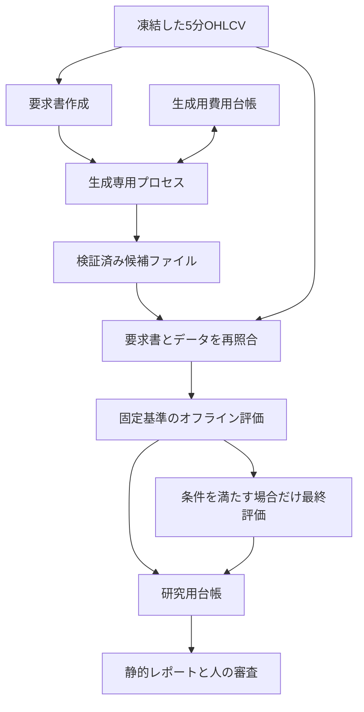

# AI自己改善エンジン 技術書

対象版：`ai-self-improvement-v0.2`（2026-11-06 JST）。権限と採否の正本は [SOURCE_OF_TRUTH.md](SOURCE_OF_TRUTH.md) です。
本書はその実装方法を説明します。予定の機能と実装済み機能を混同しないでください。

## 1. 構成と権限

本版は二つの生成経路を持ちます。既存fixture探索はオフラインで最大8試行、Phase 2は要求書から1候補だけを生成し、別プロセスで評価します。Phase 2の評価結果から次の実API要求を自動作成するループはありません。



既存Botへの設定書込み、注文、残高更新、デプロイの接続は設けません。評価器は既存`app/strategy.py`の純粋な計算関数を参照しますが、worker、DB、取引所クライアントを起動しません。生成用イメージにはBot・評価器・PostgreSQL driverを含めず、専用のstateと成果物へだけ書き込みます。

| モジュール | 役割 |
|---|---|
| `policy.json` / `contracts.py` | 研究数値、候補Schema、型・範囲・環境の拒否条件 |
| `dataset.py` | 凍結CSV検査、時間順分割、合成入力 |
| `provider.py` | fixture、Responses要求・応答の基本契約 |
| `proposal_context.py` | 要求書の型・束縛、固定wire requestの構築 |
| `phase2_policy.py` | 固定model・料金版・予約額・usage検証 |
| `phase2_budget.py` | 初期化済み専用台帳、原子予約、固定上限、状態遷移 |
| `phase2_gateway.py` | 専用キー読込み、固定HTTPS宛先への1回送信 |
| `phase2_artifacts.py` | 要求書・receipt・候補を結合した成果物の検証と保存 |
| `phase2.py` | 明示的なinit / status / generate。既定fixture |
| `artifact_provider.py` | 評価器側の読み取り専用成果物provider |
| `evaluator.py` / `screening.py` | 指標・時系列約定・資金・費用の計算、固定採否基準 |
| `ledger.py` / `engine.py` | 研究試行、manifest、holdout使用、監査、有限評価 |
| `report.py` / `__main__.py` | 静的HTML、オフラインCLI、要求書作成・成果物評価 |

研究機能はPython標準ライブラリで動きます。評価器へOpenAI SDK、APIキー、Coincheck資格情報、PostgreSQL接続情報を渡しません。通常Botの依存関係は別に管理します。

## 2. 候補JSONの意味

`proposal_schema()` がポリシーからJSON Schemaを構築します。すべてのフィールドを必須とし、`additionalProperties=false` とします。
受信側でもローカル検証を行います。JSON Schemaだけでは表し切れない `ema_fast < ema_slow`、必須フィルター、フィルター重複も確認します。

```json
{
  "schema_version": "1",
  "name": "research-candidate-example",
  "timeframe_minutes": 120,
  "ema_fast": 21,
  "ema_slow": 55,
  "rsi_period": 9,
  "rsi_threshold": 55,
  "rsi_window": 3,
  "atr_period": 14,
  "stop_atr": 3,
  "target_atr": 12,
  "entry_filters": ["local_trend", "slow_rising", "higher_trend", "rsi_cross"],
  "volatility_cap_pct": 10.0
}
```

この例は固定比較戦略と同じ候補であり、成績改善を示す推奨パラメータではありません。

| 条件名 | 決定時点で評価する式 |
|---|---|
| `local_trend` | close > EMA_fast > EMA_slow |
| `slow_rising` | EMA_slow[t] > EMA_slow[t−3] |
| `higher_trend` | 確定4h close > EMA50 > EMA200 |
| `rsi_cross` | 過去window本以内にRSIが閾値を上抜け、現在も閾値以上 |
| `volatility_cap` | ATR / close × 100 ≤ volatility_cap_pct |

候補名は識別用です。戦略hashから候補名を除き、条件順を正規化します。
未使用のvolatility_cap値も戦略hashから除きます。同じ戦略を名前だけ変えて繰り返す候補を区別しません。

買い金額、最大保有、手数料、評価区間、採否条件、保存先、モデル名、URL、Pythonコードを候補に含めると拒否します。

## 3. データと先読み防止

データの最小単位は5分足です。相場データの取込と研究を分離するため、MVPは公開APIへ接続しません。
既存Botが記録したデータを使う場合も、別途レビューした読み取り処理でスナップショットを作り、このMVPへファイルとして渡します。

CSVのフォーマットとコマンドは [運用手順](OPERATIONS.md) に定義します。
数値は有限値、OHLCの大小関係、時刻はUTC・5分境界・厳密な時間順で検査します。
先頭から末尾まで連続していないCSVを、黙ってソート・重複除去・補間しません。

集約足の始値・終値は時刻順の最初と最後、高値・安値は区間内の最大・最小、出来高は合計です。
構成要素が足りない先頭・末尾区間は完備した集約足として扱いません。
上位足は `higher_start + 4h <= signal_close` のものだけを使用します。
同じ時刻に2hと4hが閉じた場合、その4hの終値は確定しているので利用できます。

期間分割は時刻順に固定し、50日の準備期間を先に確保します。
学習統計と開発区間の結果だけを候補生成器へ渡し、最終評価の価格・成績を渡しません。
これはMVPの時系列分割と3期間の頑健性試験です。CSCV、PBO推定、完全なwalk-forward最適化を実装済みとは扱いません。

ニュースについては公開時刻だけでなく**当システムが利用可能になった時刻**が必要です。
後から改稿された本文や現在の要約を、過去時点で読めたニュースとして入れると先読みになります。
このためニュース効果のバックテストはMVPに含めません。

## 4. 指標の初期化と比較戦略

既存 `app/strategy.py` のEMA、Wilder平滑化、RSI、ATRの計算方法を参照します。

- EMA係数は `2 / (n + 1)`。初期値は入力系列の最初の値。
- Wilder平滑化は最初のn値の平均から始め、その後は `(前値 × (n−1) + 新値) / n`。
- RSIは確定終値の変化幅から計算。上昇・下落とも0なら50、下落だけ0なら100。
- ATRは当該足の高安差と前終値からのギャップの最大値をWilder平滑化。

同じ式でも参照する履歴長と初期値が異なれば境界付近の判定は変わり得ます。
MVPは既存workerの参照上限と同じ直近450本を、各判定時点で切り出して指標を初期化します。上位足もその時点で確定した直近450本です。
準備本数はローカル200本・上位300本です。比較試験は上位足が450本を超える期間も含み、既存評価関数へ同じ窓を渡して判定と数値を照合します。
固定比較戦略と既存評価関数との一致試験はシグナル部分を対象とし、取引所約定の同等性まで保証しません。
既存market workerには確定猶予と板照会があり、本MVPの5分OHLCVモデルとは執行条件が異なります。

## 5. 約定・資金・決済モデル

1. 確定した決定足からシグナルを作る。
2. そのシグナルを利用できる次の5分足始値を基準に購入する。
3. 1回の支出は `min(利用可能JPY, 設定した購入予算)`。BTC数量を8桁に切り下げる。
4. 最小数量・最小金額を満たさなければ購入しない。保有中は追加購入しない。
5. シグナル時のATRを使い、約定価格からSL/TPを固定する。
6. その後の5分OHLCVで決済を評価する。両方に触れる足は損切り優先。
7. ストップを飛び越えて始まった場合、良い価格へ都合よく戻して決済しない。
8. 評価末の保有を別に示し、比較用の期間末決済を実戦略の出口と区別する。

通常売却にも0.001 BTC / 500円の研究用制約を適用します。最低金額を満たさなければ保有を継続し、`rejected_exits` を増やします。
期間末の清算は比較用評価であり、最低注文金額を満たした実行可能な注文とは扱いません。

費用の式は以下です。bpsは1万分の1を表します。

```text
片道の不利な価格調整 = 往復スプレッド / 2 + 片道滑り
買い価格 = 基準価格 × (1 + 不利な価格調整 / 10000)
売り価格 = 基準価格 × (1 - 不利な価格調整 / 10000)
買い現金支出 = 数量 × 買い価格 × (1 + 手数料bps / 10000)
売り手取り = 数量 × 売り価格 × (1 - 手数料bps / 10000)
```

費用2倍は手数料・スプレッド・滑りの仮定を同時に2倍にします。
価格の離散化、約定までの遅延、注文板・キャンセル・部分約定を正確に再現するモデルではありません。
50,000円の予算を守ったことと、実市場で50,000円分を同条件で約定できることは別です。

## 6. 指標と選抜

評価器が利益・件数・最大下落率・保有時間等を計算します。AIに損益を採点させません。

```text
純利益 = 評価終値の資産（所定の費用込み処理後） - 初期仮想資金
途中の時価評価 = 利用可能JPY + 保有BTC × 当該5分足終値
最大ドローダウン = max((過去最高資産 - 現在資産) / 過去最高資産)
Profit factor = 通常決済の利益合計 / 通常決済の損失絶対値合計
最大1件への依存度 = 最大の正の損益 / 正の損益の合計（期間末評価益も含む）
```

損失取引がない場合のPFを無条件に「無限大で優秀」と判定しません。
件数、費用、期間別安定性、固定戦略との差、利益集中を別に検査します。
初期の採否閾値は正本とpolicyに定義します。固定閾値を実験成績に合わせて自動的に緩めません。

途中の時価評価と `mark_to_market_equity_jpy` は、将来の売却費用を控除しない終値評価です。
期間末の仮想清算後の `liquidated_end_equity_jpy` は売却費用を含みます。
最大ドローダウンは5分終値評価と最後の仮想清算時点から計算し、5分足内部の最大逆行までは測定しません。
`closed_trades`、勝敗数、勝率、PF、`realized_pnl_jpy` は通常決済だけを数えます。
`period_end_pnl_jpy` は評価用の末尾清算損益、`total_exit_records` は通常決済と末尾清算を合わせた履歴件数です。純利益は通常の実現損益と末尾清算損益の合計です。
`unrealized_pnl_jpy` と `open_position_btc` は期間末清算の直前の状態を示すので、清算後の評価額や純利益へ重ねて加算しません。

開発全期間を連続評価した損益を順位付けに使います。
3分割の各結果は安定性検査用で、それぞれ独立資金・未保有から開始します。
期間を分割した成績の合計と連続運用の成績は一致する必要がありません。

最大利益を見つけても、サンプルが不足すれば不採用です。
「改善候補なし」はエラーではなく正常な結論です。

## 7. Phase 2のAPI契約と成果物

### 7.1 要求書とAPI入力

`prepare-proposal`はCSVの品質検査と時間順分割を行い、固定baselineをparentとするtrial 0のcontextを作成します。要求書にはversion、context、binding、envelope hashを持たせます。bindingはデータhash、区間、購入予算、policy、正本を含むコード、baseline、prompt、schema、model、出力上限、wire requestのhashに結び付きます。

生成器は要求書を検証してwire requestを再構築します。modelへ渡すのは`validate_context()`を通ったcontextだけです。要求書のbindingをプロンプトへ丸ごと連結せず、CSV、最終区間の価格・成績、取引口座、秘密を送信しません。本版は開発フィードバックが空の最初の1候補に限定します。

Responses要求は固定model、`store:false`、`tools:[]`、`tool_choice:none`、`service_tier:default`、最大出力2,048tokenを指定します。`text.format`は`json_schema`、`strict:true`です。APIへ送るschemaは互換性を考慮した型とenum中心のsubsetで、名前・範囲・EMAの大小・必須filter等はローカルで追加検証します。wire schema hashとローカルpolicyを別に記録します。

### 7.2 応答検証

- 固定HTTPS宛先とpathへ1回送信し、自動retry・任意URL・redirect先への再送を行わない。
- 応答サイズ、JSON重複キー、非有限数、未知の出力形式を検査する。
- `status=completed`、単一のassistant出力、拒否・不完全・errorの不存在を確認する。
- modelが固定snapshotと一致し、usageが非負整数で出力上限・合計・予約額と整合することを確認する。
- 候補DSLを再検証する。数量、実行権限、採否基準、URL、コードの注入を拒否する。
- 例外本文やHTTP error bodyをログへ出さず、固定の分類コードで失敗を記録する。

Structured Outputsの受理、対象キーのmodel利用可否、実HTTPの遅延・失敗挙動、課金は、fixture試験だけでは証明しません。[Structured Outputs公式資料](https://developers.openai.com/api/docs/guides/structured-outputs)

### 7.3 保存と再照合

候補成果物は要求書、検証済みcandidate、semantic candidate hash、生成方式、完了receipt、全体hashを含みます。receiptにはmodel、response ID、usage、予約・料金policy識別子、予約額、usage換算額、作成・完了時刻、応答hashを結び付けます。生のAPI応答や秘密は成果物へ含めません。

専用ディレクトリへ、サイズを限定したregular fileを所有者限定権限で作成します。symlink、未知キー、改ざん、不完全保存、既存の別内容への上書きを拒否します。予算台帳をCOMPLETEDへ確定してから成果物を保存するため、その間で中断したときは「完了receiptはあるが成果物なし」となります。この状態を自動再送で埋めず、証跡を保全して停止します。

`evaluate-artifact`は、同じCSV・設定・現在の評価コードから要求書を再構築し、保存された要求書と全照合します。成果物を単独の命令や任意providerとして実行しません。exact `FixtureProvider`またはexact `ArtifactProvider`だけを入口にし、継承や任意transport注入による拡張を拒否します。成果物の評価は1試行固定です。

hashは内容の対応を検出する仕組みであり、提供元署名ではありません。ファイルを書き換える権限を持つ所有者がhashも再計算した場合まで、実APIの真正性を保証するものではありません。生成記録・台帳・固定releaseと併せて確認します。

### 7.4 費用の算出と予約

2026-11-06確認のGPT-4.1公式仕様を基に、全コンテキスト1,047,576tokenと出力上限2,048tokenを、割引なしの入力2 / 出力8 microUSD毎tokenで計上し、2,111,536 microUSDを予約します。入力サイズから不確かなtoken見積りを作るより保守的な方法であり、毎回その額が請求されるという意味ではありません。[固定モデル公式仕様](https://developers.openai.com/api/docs/models/gpt-4.1)

`actual_microusd`は応答usageを通常単価で換算した監査値です。キャッシュ割引・請求書・税・為替は反映せず、実支出の確認とは区別します。fixtureのusageと換算額は模擬値です。本版では成功後も差額を解放せず、予約額の累積を上限制御に使用します。

料金版と確認期限を台帳に固定し、期限切れや変更を検出したら新規live送信を停止します。モデルは2027-01-14停止予定で、料金の期限は2026-12-06 00:00 UTCです。別modelへの自動fallbackはありません。[公式廃止予定](https://developers.openai.com/api/docs/deprecations)

## 8. 二つの独立した台帳

### 8.1 評価側の研究台帳

SQLiteは研究専用ディレクトリ内に作ります。既存の無関係なファイルがあるディレクトリ、symlink、未知のmarkerは拒否します。
マーカーは既存DBを書き換えてよい承認ではなく、専用出力領域であることの確認に使います。

| テーブル | 主な内容 |
|---|---|
| `metadata` | 台帳Schema版 |
| `runs` | immutable manifestとhash、開始・終了・結果 |
| `trials` | 予約済み試行、候補、候補hash、結果・理由 |
| `final_tests` | 消費した最終評価期間、候補hash、結果 |
| `events` | 状態変更の監査イベントとhash連鎖 |

プロセスの単一起動ロックに加え、`run_id + trial_index` を主キーとし、`BEGIN IMMEDIATE` で試行予約と監査を確定します。
候補予約は生成器呼出しより先です。ディスク書込みに失敗したら生成を続行しません。
最終評価はデータhashだけでなく期間の重なりも確認し、少しデータを追加しただけで同じ期間を再評価することを防ぎます。

監査テーブルは更新・削除をトリガーで拒否します。実験manifestも同じrunの途中で差し替えできません。
ファイルを管理する所有者がDB全体を置き換える行為まで防ぐものではありません。

### 8.2 生成側の費用台帳

`--state`の配下でfixtureとliveを分離します。各modeのprivate directoryは、markerと固定名`budget.sqlite3`を持ちます。`init`だけが空の専用領域を初期化します。`generate`はDBがなければ停止し、新しいDBを自動作成しません。

上限は正の整数5項目です。1回金額 ≤ 日次金額 ≤ 累積金額、日次回数 ≤ 累積回数を要求し、上限と料金policy hashを保存します。既存台帳へ別の上限・料金版を渡して上書きしません。金額の単位はUSDの100万分の1です。

送信前の予約では`BEGIN IMMEDIATE`を使い、request/context hash、時刻、固定予約額、モデル・料金版、回数と監査を同一トランザクションで確定します。request hashを一意にし、並列プロセスの確認と挿入を分離しません。完了処理はRESERVEDからCOMPLETEDまたはFAILEDへの一方向の遷移です。

UTC日付で日次枠を管理します。当日予約、過去日の未確定・失敗予約、過去日の予約で当日に完了した分を、いずれも満額で当日の費用露出へ計上します。これは予約日・完了日に基づく保守的制限で、提供者の会計日の保証ではありません。時刻の巻戻しは拒否します。累積枠と試行数は翌日も補充しません。台帳全体の削除・別volumeの使用・別用途のキー利用は、技術的な予算制御の外側です。resetやtop-upで継続する操作は用意しません。

## 9. 再起動と障害

| 検出した状態 | 処理 |
|---|---|
| 評価run完了・manifest一致 | 保存済み結果を返す。再生成・再評価しない |
| 評価runのmanifest不一致 | 拒否。コード・入力・候補の変更を調べる |
| fixture探索の予約だけ残り候補なし | 中断試行として失敗確定し、回数を消費 |
| 評価候補保存済み・結果なし | 同じ候補を同じデータ・評価器で評価する |
| 最終評価予約済み・結果なし | 期間は消費済み。別候補でやり直さない |
| generatorの同requestがRESERVED / FAILED | 新規HTTPを送らない。予約を保持して停止 |
| generatorがCOMPLETED・成果物が有効 | 保存済み候補を返す。HTTPなし |
| generatorがCOMPLETED・成果物欠損 / 不整合 | 自動再送せず停止。台帳・証跡を保全 |
| HTTP失敗 / 拒否 / model・usage不整合 | 失敗記録を残し予約額を保持。retryなし |
| 日次・累積枠 / 期限 / 台帳・保存異常 | 新しい候補生成を止める。Bot操作は送らない |

常駐の自動回復サービスや定期研究ジョブは本版にありません。研究の失敗によって既存Botの決済監視を止めたり、口座を初期化したりしません。

## 10. Docker隔離

各Composeファイルはstandaloneです。既存BotのComposeと合成せず、fixture用とlive用も重ねて読み込みません。

| 実行構成 | 通信 | 秘密 | 主な入出力 |
|---|---|---|---|
| `compose.ai-lab.yaml` | `network_mode:none` | なし | 専用研究volume |
| `compose.ai-lab.phase2.yaml` | `network_mode:none` | なし | read-only要求書・limits、専用生成state |
| `compose.ai-lab.phase2.live.yaml` | 専用egress network | generator用キーだけ | read-only要求書・limits、live専用台帳領域 |

生成器は非root UID10002、評価器はUID10001です。rootfs read-only、capabilities全削除、no-new-privileges、CPU・メモリ・PID・tmpfs・ログ上限を適用します。公開ポート、Docker socket、host network、privileged、BotのPostgreSQL接続は設けません。書込み対象はそれぞれの専用volumeです。

生成イメージは許可する小さいモジュール集合だけをCOPYし、Botや評価器を持ちません。評価イメージにHTTP関連モジュールのファイルが存在しても、それを通信権限がある証拠とは扱いません。評価CLIの入口制限、秘密拒否、Dockerのnetworkなしを組み合わせます。

live生成器のコードは`api.openai.com`へのHTTPS要求に固定します。一般のDocker bridgeがドメイン単位で外向き通信を制限するわけではありません。ホストPythonでCLIを実行しただけでもOSの通信遮断は成立しません。この違いを実隔離試験の記録に残します。

Compose secretsはファイルmountです。ホスト侵害に耐える保管庫ではなく、ファイルbind型の実装では設定したuid/modeが期待通り変わらない場合があります。実キーを使う前に、内容を表示せずに実行UID・親ディレクトリ・file mode・read-only mount・必要プロセスだけの読取りを確認します。

成果物は生成側から明示的にコピーし、評価側へ読み取り専用入力として渡します。予算DBやキーを評価器へ共有してはいけません。ファイルの権限と所有者は受け渡し先で再確認します。コンテナ分離はホスト管理者侵害への完全防御ではありません。

## 11. 結果画面と公開範囲

HTMLは保存済み台帳から生成する静的ファイルです。現在の残高・価格・運転状態をリアルタイム表示する画面ではありません。
合成/実データ区分、fixture/成果物の生成方式、上流の生成記録、評価器の通信0、試行数、購入予算、固定戦略との比較、不採用理由、最終評価の使用状況、manifestを表示します。上流呼出しの表示は当該成果物の完了応答申告であり、失敗を含む全試行数は生成費用台帳で確認します。fixtureのusage・費用は模擬値として扱い、実課金とは表示しません。
文字列はHTML escapeし、JavaScript・外部フォント・外部画像・外部APIを使いません。CSPは `default-src 'none'` とします。

新しいHTTP管理APIを追加していないため、既存フロントの認証境界を変更しません。
将来フロントへ統合する場合は、既存の認証付きGET経路へ読み取り専用の研究結果を追加し、研究の実行・昇格は別権限として設計します。

## 12. 残る技術課題

実データの独立検証、板・取引費用の校正、長い保有期間を考慮した標本数、候補数を踏まえた統計検定、継続的な将来データ比較が必要です。
価格データの真正性はhashだけでは証明できません。hashは同一性を確認する仕組みです。
実OpenAI応答・対象プロジェクトの利用可否・実請求照合・生成品質は別途検収が必要です。多段の実AI探索、定期実行、自動採用、任意Pythonのコード生成・隔離実行は未実装です。費用台帳の制御は同じ永続stateを保持する範囲で、他用途のAPI利用やホスト側の履歴破棄は集計しません。

この技術書だけを根拠に実売買へ切り替えることはできません。今回の実施範囲は[Phase 2検収書](ACCEPTANCE_PHASE2_20261106.md)、過去MVPは[2026-11-05の記録](ACCEPTANCE_20261105.md)で確認してください。

## 参考資料

- [OpenAI Structured Outputs](https://developers.openai.com/api/docs/guides/structured-outputs)
- [OpenAI Evaluation best practices](https://developers.openai.com/api/docs/guides/evaluation-best-practices)
- [OpenAI Safety in building agents](https://developers.openai.com/api/docs/guides/agent-builder-safety)
- [Bailey et al., The Probability of Backtest Overfitting](https://www.davidhbailey.com/dhbpapers/backtest-prob.pdf)
- [Cerqueira et al., Evaluating time series forecasting models](https://kt.ijs.si/igor_mozetic/papers/CerTorMoz-TimeSer-MACH-20.pdf)

研究の多数試行による選択バイアスを理由に、試行履歴と最終期間の保護を設計しています。
これらの論文の検定手法全体をMVPに実装したという意味ではありません。
